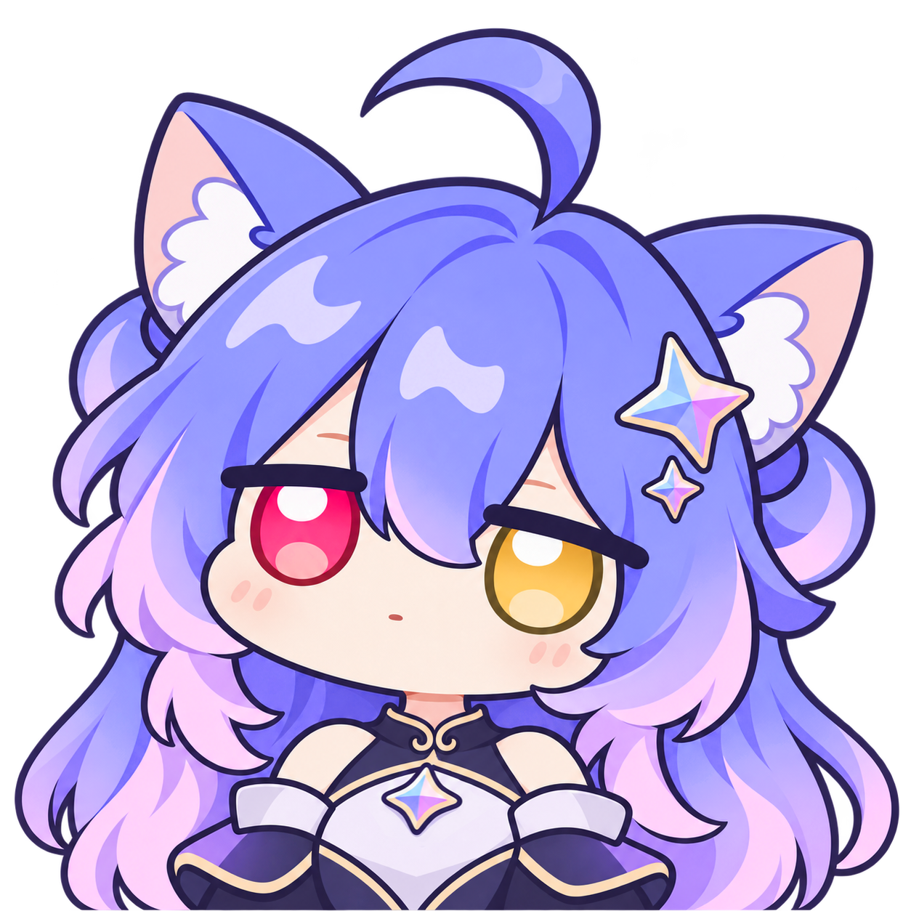
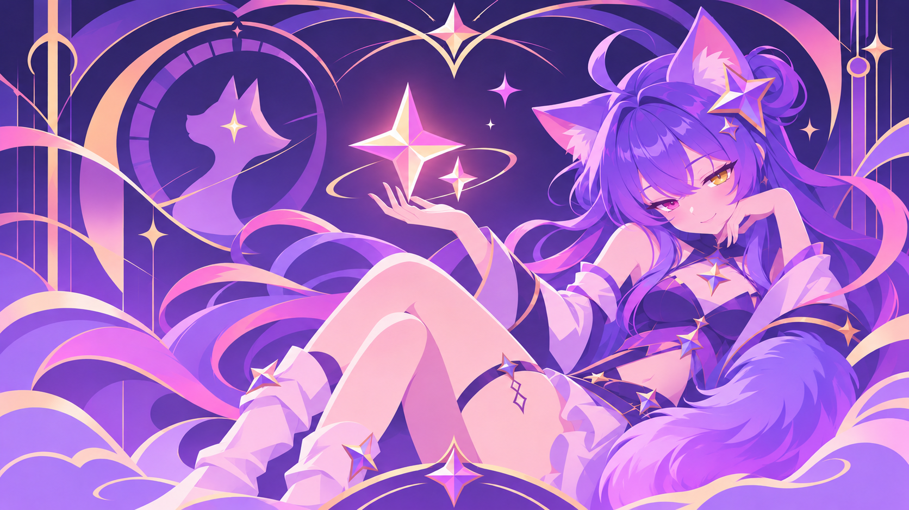

# Catstella

[English](README_EN.md) | [简体中文](README.md)

Catstella is an open-source desktop enhancement and dual-end companion suite designed for Google Antigravity and the Google Gemini ecosystem. It features an interactive desktop pet widget (Cat Widget), a frosted glass UI theme and wallpaper engine (Dream Skin), and a dedicated web companion extension tailored specifically for the official Google Gemini web client (`gemini.google.com`).

> **Disclaimer & Security Notice**  
> This project is a non-commercial, community-driven tool maintained by open-source enthusiasts. It is **NOT an official Google product** and is not affiliated with, endorsed by, or sponsored by Google or any of its subsidiaries.  
> Catstella reads quota data and applies styles through the host’s local debugging interface and the browser extension. It leaves host installation files and `app.asar` intact. Its usage ledger and companion sync store numeric totals and status rather than conversation text.

---

## 🎨 Gallery & Artworks

| Default Character (Stella) | Default Stock Wallpaper (Stella Sheet) |
| :---: | :---: |
|  |  |

> [!TIP]
> Includes two Gemini gijinka characters, Stella and Aica, with proud, annoyed, shy, and napping expressions, plus four bundled wallpapers. See [ASSETS.md](ASSETS.md) and the [online catalog](online-assets/README.md).

---

## 🌟 Key Features

### 🐱 Desktop Companion Widget (Cat Widget)
- **Multi-Model Quota Monitoring**:
  - Read-only telemetry extraction from the host background service for **Gemini 5-hour / Weekly limits** and refresh countdowns;
  - Displays the dedicated Argon weekly WTU quota when the host provides it, alongside the standard weekly quota. Low quota triggers a warning and a character reaction.
  - Customizable honorifics and forms of address in settings (None, Zayu, or custom text).
- **Interactive Feedback**:
  - 50+ localized dialogue quips, subtle breathing animation, and ambient edge luminescence;
  - Click the mascot’s head for expressions, or use the menu to dock it in either bottom corner;
  - Preview expressions in settings. The pet naps when idle and wakes on click. Four sound sets are available and muted by default.
- **Anti-Flicker & Desktop Persistence**:
  - Tracks foreground windows and supports display priorities. A duplicate pet can still appear with the floating Windows taskbar. See the [roadmap](docs/ROADMAP.md).
  - **Standalone Desktop Mode**: Persists reliably on the desktop even when Antigravity is closed or minimized, seamlessly reattaching upon host relaunch.

The desktop Pet and Wallpaper pages show the online catalog and notify you about assets you can install. If GitHub is unreachable, the gallery asks you to check your connection or proxy; installed assets remain available. The About page offers update checks and online palettes. Idle chatter is optional. The [catalog](online-assets/README.md) is served from the GitHub `main` branch. The Windows installer excludes the experimental BYOK gateway; see the [roadmap](docs/ROADMAP.md).

### 🔮 Frosted Glass Theme & Wallpaper Engine (Dream Skin)
- **Translucent Architecture**:
  - Reconstructs the input composer into an elevated frosted capsule, eliminating dark background block artifacts and allowing wallpapers to show through naturally;
  - Enforces complete opacity protection for code editors (Monaco) and terminals (xterm) to maintain contrast and readability;
  - Smooth S-curve gradual fading for scrolling message history.
- **Four Palette Themes**:
  - Native CSS variables dynamically injected: **Violet**, **Pink**, **Ocean**, and **Onyx**;
  - Harmonious styling across the top-right Overview floating window and dropdown menus.
- **Wallpaper Slideshow System**:
  - Smooth crossfade transitions between wallpapers;
  - **1m to 60m proportional slider** with magnetic damping near common intervals; automatically scans the user's wallpaper directory.

### 🌐 Gemini Web Companion · Adapted for Official Google Gemini Web (`gemini.google.com`)
Extending beyond the local Antigravity IDE, Catstella provides full-featured integration for the official **Google Gemini web application (`gemini.google.com`)**:
- **Official Webpage UI & Desktop Pet Injection**:
  - Native support across Edge, Chrome, and Firefox;
  - Injects a panoramic frosted glass theme (Liquid Glass) consistent with the desktop aesthetic;
  - Mounts an interactive catgirl companion in the bottom-right corner of the official chat interface with multiple expressions and animations;
- **Dedicated Web Telemetry & Consumption Tracking**:
  - Displays the five-hour and weekly usage and reset times when Gemini provides them, with the source labeled.
  - Counts turns in the current conversation and estimates its token load.
- **Desktop and Web Sync (Companion Bridge)**:
  - Local auto-handshake via loopback `127.0.0.1:3921–3923`;
  - **Cross-Display Telemetry**: View Gemini Web metrics directly on Page 2 of the desktop pet bubble, and inspect Antigravity IDE quotas inside the web extension popup;
  - **Asset & Preference Sync**: One-click toggling between synchronized character packs and wallpaper galleries, or independent customization;
  - **Pet Visibility**: Show both pets, hide the web pet while the desktop suite is online, or hide the desktop pet while Gemini is in focus.

### 🌐 Localization Layer
- Pure CDP injection without tampering with `app.asar`, completely reversible at any time;
- Comprehensive translation covering 830+ UI elements, input placeholders, button tooltips, and accessibility labels;
- Defaults to standard English, with one-click toggling to Simplified Chinese in settings.

---

## 🛠️ Installation & Getting Started

### Option A: Windows Installer (Recommended)
The Windows x64 release ships the desktop suite and optional Web extension component in a single installer:
1. Download the latest `Catstella-Setup-*-x64.exe` from [Releases](https://github.com/lynnfei/Catstella/releases);
2. Run the installer and choose **Full installation** to use desktop and web sync. Startup and host launch integration are optional. The default installation is per user and normally requires no administrator privileges;
3. Open `web-extension/web-plugin-guide.html` in the installation folder. For Edge or Chrome, extract the ZIP, enable Developer mode on the browser's extensions page, and load the folder containing `manifest.json`. For Firefox, temporarily load the bundled unsigned XPI through `about:debugging` and reload it after restarting the browser.

### Option B: macOS / Linux Experimental Packages

[Releases](https://github.com/lynnfei/Catstella/releases) offers experimental builds for macOS (Apple Silicon and Intel, `.dmg` / `.zip`) and Linux x64 (`.AppImage` / `.tar.gz`). These desktop builds have not completed testing on physical machines and do not bundle the Web extension. Use `SHA256SUMS.txt` from the same release to verify downloads for any platform.

### Option C: Run from Source
Prerequisites: Windows 10/11 x64, Node.js 22.12 or later, and .NET Framework 4.x.

```powershell
# 1. Clone repository
git clone https://github.com/lynnfei/Catstella.git
cd Catstella

# 2. Install dependencies & compile native helper
npm ci
npm run build:native

# 3. Launch desktop suite
npm run start:widget

# 4. Run automated test suite
npm test
```

Shortcuts: `Ctrl+Alt+G` brings the widget forward; `Ctrl+Alt+Shift+G` disables click-through. Open Settings from the widget button or the tray menu.

---

## 🔒 Privacy & Local Data Boundaries

| Data Type | Local Storage Location | Description |
| :--- | :--- | :--- |
| Settings & Ledger | `%USERPROFILE%/.antigravity-cat-widget/`<br>`%USERPROFILE%/.antigravity-dream-skin/` | Stores local UI preferences, scale factors, and numeric usage ledgers. |
| Host Telemetry | `%USERPROFILE%/.gemini/antigravity/brain/` | Reads local logs for step counts and token metrics. The ledger stores usage statistics. |
| Local Loopback | `127.0.0.1:3921–3923` (Loopback only) | Listens only on localhost and checks browser request origins. |

- Settings, usage ledgers, and companion sync stay on the device. Update checks and the online gallery request release information or assets from the project’s GitHub repository.
- Turn Dream Skin off in settings to remove the applied styles from the current host window.

---

## 📜 License & Asset Notice

1. **Software License**: Original source code is licensed under the [MIT License](LICENSE).
2. **Artwork & Non-Code Asset Restrictions**:
   - **The MIT license DOES NOT apply to any character artworks, illustrations, wallpapers, or non-open-source audio files.**
   - Character design reference is attributed to provider record [ZipZipPipe (Bilibili Space)](https://space.bilibili.com/4168597) as the original concept designer; character and concept artworks are AI-assisted generations with generation prompts preserved, and do not claim Google official endorsement or relicensing rights for original designs. The public release excludes author reference artworks, private screenshots, or unconfirmed redistributable DSH audio assets.
   - **Ownership of the pink-haired Gemini character design belongs to the repository maintainer. Usage and derivative creations must adhere to the CC BY-NC-SA 4.0 license.**
   - Audio effects are licensed under their respective sources (Kenney CC0 / Upstream MIT synthetic audio); see [ASSETS.md](ASSETS.md) and [NOTICE.md](NOTICE.md) for full attribution.
3. **No Warranty**:
   - Catstella relies on local CDP interfaces and DOM selectors of the host. Future host updates may alter layouts or internal APIs.
   - Developers provide no warranty and assume no liability for display anomalies, caching inconsistencies, or other side effects resulting from the use of this unofficial tool.

---

## 💐 Acknowledgements

This project was developed with reference to and derivative of the following open-source projects and original designs:

- **[Monokumakuki / Antigravity-Star-Suite](https://github.com/Monokumakuki/Antigravity-Star-Suite)**: Upstream project that provided the original architecture, CDP probes, and companion prototypes;
- **[ZipZipPipe (Bilibili Space)](https://space.bilibili.com/4168597)**: Original concept designer of the Gemini Star Neko;
- **[Feeesack / codex-maid-widget](https://github.com/Feeesack/codex-maid-widget)** & **[MeteorNOX / DeepSeek-Balance-Whale-Widget](https://github.com/MeteorNOX/DeepSeek-Balance-Whale-Widget)**: Appreciation to both pioneering projects for open-source inspiration regarding companion interaction, thought bubbles, and telemetry observation.
